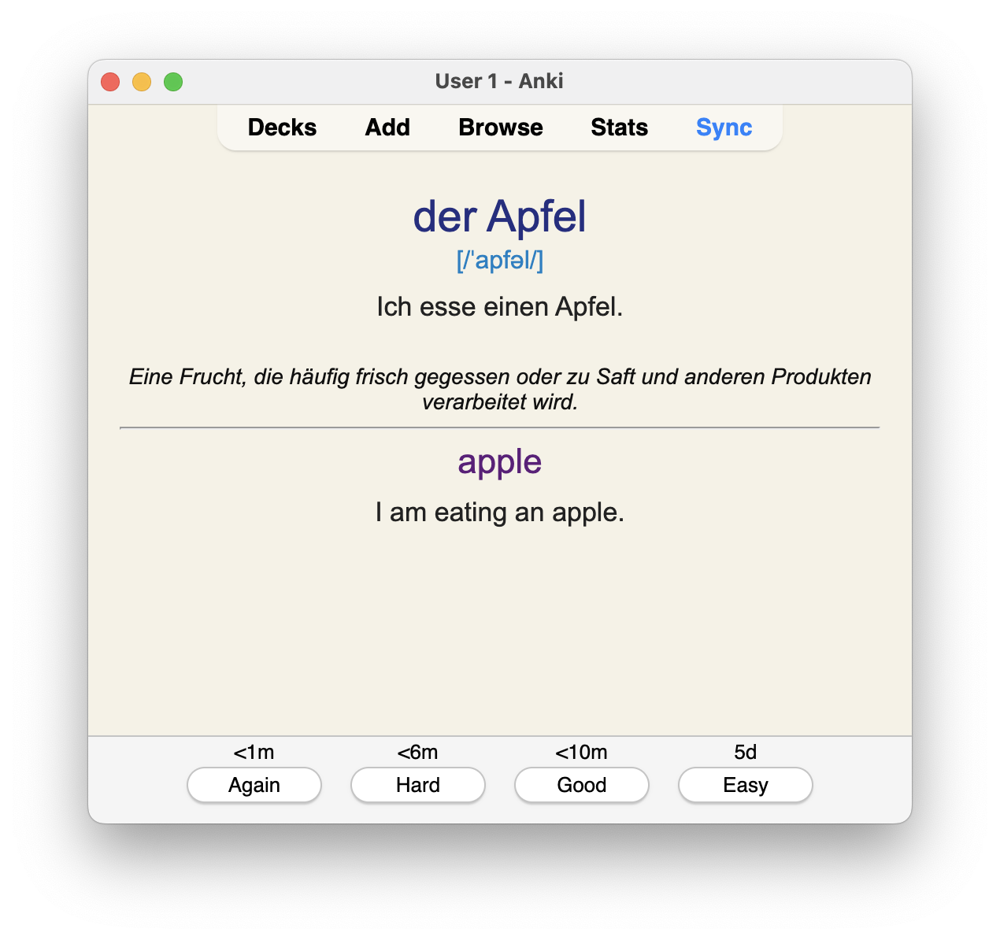

# Lingo

[Try it now](https://lingo.lanbin.dev/)

## Overview
Lingo is a web application that helps language learners create high-quality Anki flashcards using AI.\
It automatically generates cards with translations, examples, transcription and more to enhance the learning experience.

## Features
🎯 Card templates designed for effective learning\
🌍 Support for multiple languages\
⚡️ Instant card generation powered by OpenAI\
🔄 Two-sided cards for practicing translations in both directions\
👤 Create personalized collections\

<p align="center">
  
</p>


## Supported Languages
- English
- German
- Russian

Feel free to contribute by adding support for more languages!

## API Reference

### Authentication
All API requests must include an `Authorization` header with a valid bearer token:
```
Authorization: Bearer <your-api-key>
```

### Get Card

`GET /api/collections/{collection}/cards/{word}`

**Parameters:**
- `collection`: Collection slug (e.g., "de-en" for German-English)
- `word`: Word to get card information for (e.g. "apfel")

**Response:**
```json
{
  "word": "Apfel",
  "plural": "Äpfel",
  "translations": [
    {
      "pos": "Nomen",
      "translations": [
        "apple"
      ]
    }
  ],
  "article": "der",
  "gender": "m.",
  "transcription": "/ˈapfəl/",
  "context": "Der Apfel fällt nicht weit vom Stamm.",
  "context_translation": "The apple doesn't fall far from the tree.",
  "definition": "Eine weit verbreitete Obstart, die rund, meist rot, grün oder gelb ist."
}
```


### Generate Anki Package
`POST /api/collections/{collection}/apkg`

Generates an Anki package (.apkg) file containing cards for the specified words. 
The generated file can be directly imported into the Anki app to add the flashcards to your decks.

**Request Body:**
```json
{
  "words": ["word1", "word2", "word3"]
}
```

**Response:**
```json
{
  "url": "http://localhost:9000/lingo/apkg/..."
}
```

## Development

### Prerequisites
- Go 1.24 or higher
- Docker
- Node.js (for TailwindCSS)

### Local Setup
1. `git clone https://github.com/la0rg/lingo.git`
2. Run `make up` to start required services (MinIO, DynamoDB)
3. Run `make css` to build CSS
4. Run `make run` to start the application

### OpenAI Configuration
By default, the application runs with a mocked OpenAI API for development purposes. To use the real OpenAI API:

1. Set `mockopenai: false` in `config.yaml`
2. Provide your OpenAI API key either:
   - Through environment variable: `OPENAIKEY=your-api-key make run`
   - Or in `config.yaml`:
     ```yaml
     openaikey: "your-api-key"
     mockopenai: false
     ```


### Live Reload
For a better development experience with automatic reloading:

1. Run `make up` to start required services
2. Run `make css-watch` in one terminal to watch and rebuild CSS changes
3. Run `make air` in another terminal to start the application with live reload

 ## License
 This project is licensed under the MIT License - see the [LICENSE](LICENSE) file for details.